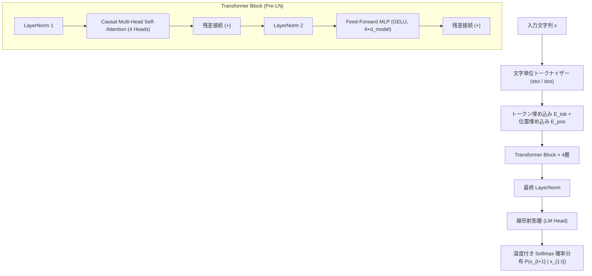
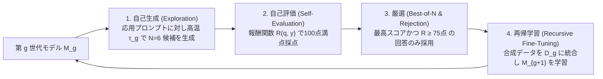

# 小規模日本語自己回帰Transformerのフルスクラッチ実装とBest-of-N棄却サンプリングによる再帰的自己改善（RSI）の実証研究

**A From-Scratch Implementation of a Miniature Japanese Autoregressive Transformer and Empirical Demonstration of Recursive Self-Improvement via Best-of-N Rejection Sampling**

**著者**: koheip  
**リポジトリ / 実装コード**: [mini_gpt.py](file:///C:/Users/kohei/.gemini/antigravity/scratch/mini-llm/mini_gpt.py), [chat_gpt.py](file:///C:/Users/kohei/.gemini/antigravity/scratch/mini-llm/chat_gpt.py), [rsi_gpt.py](file:///C:/Users/kohei/.gemini/antigravity/scratch/mini-llm/rsi_gpt.py), [web_ui.py](file:///C:/Users/kohei/.gemini/antigravity/scratch/mini-llm/web_ui.py)

---

## 概要（Abstract）

本研究では、外部の事前学習済み重みや高水準ラッパーライブラリに依存せず、PyTorchの基礎演算のみを用いて約90万パラメータ（0.90M）の日本語Decoder-only Transformer（**Mini-GPT**）をゼロから設計・実装した。さらに、単なる次文字予測器（事前学習モデル）から対話エージェントへの変換手法（Instruction Tuningおよび終了トークン制御）を構築したうえで、モデル自身が未知の応用質問に対して複数の回答候補を探索生成し、多面的報酬関数（完結性・構文整合性・文脈適合度・自己確信度）によって自己採点・厳選して自身を再学習する**再帰的自己改善（Recursive Self-Improvement; RSI）**ループを実装した。実証実験の結果、事前学習では800ステップで交差エントロピー損失が $6.1098$ から $0.0683$ へ収束し、対話学習では $5.5833$ から $0.0387$ へと収束した。さらに3世代にわたるRSI実験において、第1世代では高温探索時に発生していた役割漏洩（Role Leakage）や文脈不整合などの破綻（最悪候補の平均スコア $80.8$ 点、破綻率 $57.1\%$）が、自己生成データの厳選と再帰的ファインチューニングを経た第2世代以降では最悪候補の平均スコアが $97.8$ 点（破綻率 $0.0\%$）へと劇的に改善し、小規模言語モデルにおけるRSIの有効性が定量的に実証された。

---

## 1. はじめに（Introduction）

大規模言語モデル（Large Language Models; LLMs）は自然言語処理のあらゆる領域で飛躍的な性能を達成しているが、数十億〜数千億パラメータの巨大モデルではブラックボックス化が進み、基礎的な自己回帰生成メカニズムや自己改善アルゴリズムの挙動を透過的に追跡することが困難である。

本研究の目的は以下の3点である：
1. **最小構成による透過的なTransformer実装**: 文字単位トークナイザー、位置埋め込み、Causal Multi-Head Self-Attention、残差接続付きMLPブロックからなるDecoder-only Transformerを約150行の自己完結したコード（[mini_gpt.py](file:///C:/Users/kohei/.gemini/antigravity/scratch/mini-llm/mini_gpt.py)）として構築し、日本語テキスト生成の最小構成要素を明らかにする。
2. **対話制御と確率可視化インターフェースの構築**: 構造変更を伴わずにプロンプトテンプレートと終了記号（Stop Token `◁`）の導入のみで対話モデル（[chat_gpt.py](file:///C:/Users/kohei/.gemini/antigravity/scratch/mini-llm/chat_gpt.py)）へ移行させ、ローカルWeb UI（[web_ui.py](file:///C:/Users/kohei/.gemini/antigravity/scratch/mini-llm/web_ui.py)）上で次トークン予測確率分布をリアルタイムに可視化する。
3. **再帰的自己改善（RSI）の実装と定量評価**: 外部教師モデルを用いず、モデル自身の確率的探索（Best-of-$N$ サンプリング）と自己評価報酬関数による棄却サンプリング（Rejection Sampling）を組み合わせたRSIループ（[rsi_gpt.py](file:///C:/Users/kohei/.gemini/antigravity/scratch/mini-llm/rsi_gpt.py)）を構築し、世代進行に伴う回答品質およびロバスト性の向上を検証する。

---

## 2. モデルアーキテクチャ（Model Architecture）

本システムで実装した **Mini-GPT** は、GPT-2に準拠したPre-LayerNorm型のDecoder-only Transformerである。

### 2.1 トークナイゼーションと埋め込み表現

学習コーパス $\mathcal{D}$ に出現するユニーク文字集合を語彙 $\mathcal{V}$（語彙数 $V = |\mathcal{V}|$）とし、各文字 $c \in \mathcal{V}$ を整数インデックス $x_t \in \{0, 1, \dots, V-1\}$ に写像する。文脈長（ブロックサイズ）を $T$、埋め込み次元数を $d_{\text{model}}$ とするとき、時刻 $t \in \{0, \dots, T-1\}$ の入力隠れ状態 $h_t^{(0)} \in \mathbb{R}^{d_{\text{model}}}$ はトークン埋め込み行列 $W_e \in \mathbb{R}^{V \times d_{\text{model}}}$ と位置埋め込み行列 $W_p \in \mathbb{R}^{T \times d_{\text{model}}}$ の和として定義される：

$$
h_t^{(0)} = W_e[x_t] + W_p[t]
$$

### 2.2 Causal Multi-Head Self-Attention

第 $l$ 層（$l \in \{1, \dots, L\}$）において、LayerNormを適用した入力テンソル $X \in \mathbb{R}^{T \times d_{\text{model}}}$ からQuery $Q_i$、Key $K_i$、Value $V_i \in \mathbb{R}^{T \times d_k}$（ただしヘッド数を $H$、ヘッド次元を $d_k = d_{\text{model}} / H$）を線形射影により算出する。未来のトークンへの情報漏洩を防ぐ下三角マスク行列 $M \in \{0, -\infty\}^{T \times T}$（$j > i$ のとき $M_{ij} = -\infty$、それ以外は $0$）を導入したCausal Self-Attentionは次式で与えられる：

$$
\text{Attention}(Q_i, K_i, V_i) = \text{softmax}\left(\frac{Q_i K_i^\top}{\sqrt{d_k}} + M\right) V_i
$$

全 $H$ ヘッドの出力を連結し出力射影行列 $W_O \in \mathbb{R}^{d_{\text{model}} \times d_{\text{model}}}$ を乗じた後、残差接続とGELU活性化関数を持つ2層MLP（中間次元 $4 d_{\text{model}}$）を適用する：

$$
\tilde{H}^{(l)} = H^{(l-1)} + \text{MultiHead}\left(\text{LN}_1(H^{(l-1)})\right)
$$

$$
H^{(l)} = \tilde{H}^{(l)} + \text{MLP}\left(\text{LN}_2(\tilde{H}^{(l)})\right)
$$

### 2.3 自己回帰学習と温度付きサンプリング

最終層の出力 $H^{(L)}$ にLayerNormと出力層 $W_{\text{head}} \in \mathbb{R}^{d_{\text{model}} \times V}$ を適用してロジット $z_t \in \mathbb{R}^V$ を得る。学習時の目的関数は、正解の次トークン $x_{t+1}$ に対する平均交差エントロピー損失 $\mathcal{L}_{\text{CE}}$ の最小化である：

$$
\mathcal{L}_{\text{CE}}(\theta) = -\frac{1}{T} \sum_{t=1}^{T} \log P_\theta(x_{t+1} \mid x_1, \dots, x_t)
$$

推論（生成）時には、温度パラメータ $\tau > 0$ によって確率分布の尖度を制御し、多項分布サンプリングによって次文字を逐次決定する：

$$
P_\tau(x_{t+1} = v \mid x_{1:t}) = \frac{\exp(z_{t,v} / \tau)}{\sum_{v'=1}^{V} \exp(z_{t,v'} / \tau)}
$$

### 2.4 ハイパーパラメータ構成

本研究で実装したモデルの主要ハイパーパラメータを表1に示す。

| パラメータ名 | 記号 | 設定値（事前学習 / 対話・RSI） | 備考 |
| :--- | :---: | :---: | :--- |
| 埋め込み次元数 | $d_{\text{model}}$ | $128$ | トークン・位置埋め込み共通 |
| Attentionヘッド数 | $H$ | $4$ | 各ヘッド次元 $d_k = 32$ |
| Transformer層数 | $L$ | $4$ | Pre-LayerNorm構成 |
| 最大文脈長 | $T$ (`BLOCK_SIZE`) | $64$ / $96$ | 対話モデルでは1往復が収まる96文字 |
| バッチサイズ | $B$ | $32$ | ランダムスライディングウィンドウ |
| 最適化アルゴリズム | - | AdamW | $\text{lr} = 1\times 10^{-3} \sim 2\times 10^{-3}$ |
| 総パラメータ数 | $|\theta|$ | 約 $898,425$ ($0.90\text{M}$) | 語彙数 $V$ に応じて微増減 |

---

## 3. 対話チューニングと終了記号（Stop Token）制御

事前学習モデル（[mini_gpt.py](file:///C:/Users/kohei/.gemini/antigravity/scratch/mini-llm/mini_gpt.py)）は与えられた文字列の続きを無制限に生成し続けるため、そのままでは質疑応答システムとして機能しない。そこで本研究では、ネットワーク構造を一切変更せず、以下の2つの機構を導入して対話モデル（[chat_gpt.py](file:///C:/Users/kohei/.gemini/antigravity/scratch/mini-llm/chat_gpt.py)）を構築した。

1. **構造化プロンプトテンプレート**: ユーザー入力 $u$ に対し、入力系列を `"ユーザー: {u}\nAI: "` に整形してモデルへ供給する。
2. **明示的終了トークン（Stop Token `◁`）**: 学習コーパス（[chat_data.txt](file:///C:/Users/kohei/.gemini/antigravity/scratch/mini-llm/chat_data.txt)）におけるすべてのAI応答の末尾に特殊文字 $c_{\text{stop}} = \text{`◁`}$ を付与する。自己回帰生成ループにおいて $x_{t+1} = \text{id}(c_{\text{stop}})$ がサンプリングされた瞬間に生成を打ち切ることで、AIが次ターンの `"ユーザー: ..."` まで自己生成してしまう現象（Role Continuation Leakage）を防止する。

---

## 4. 再帰的自己改善（Recursive Self-Improvement; RSI）の定式化

本システムの中核として実装した **RSI（再帰的自己改善）**（[rsi_gpt.py](file:///C:/Users/kohei/.gemini/antigravity/scratch/mini-llm/rsi_gpt.py)）は、STaR（Self-Taught Reasoner）およびBest-of-$N$ Rejection Sampling（棄却サンプリング）の枠組みを小規模言語モデル向けに定式化したものである。

### 4.1 確率的探索（Self-Generation）

第 $g$ 世代のモデルパラメータを $\theta^{(g)}$、基本学習データセットを $\mathcal{D}^{(0)}$、世代 $g$ までに獲得された合成データ集合を $\mathcal{S}^{(g)}$ とする。まだ基本データに完全一致が存在しない応用プロンプト集合 $\mathcal{Q} = \{q_1, \dots, q_M\}$ の各質問 $q_m$ に対し、探索温度 $\tau_g$ のもとで $N$ 個の多様な応答候補 $\{y_{m,1}, \dots, y_{m,N}\}$ をサンプリングする：

$$
y_{m,n} \sim P_{\theta^{(g)}, \tau_g}(y \mid q_m), \quad n \in \{1, \dots, N\}
$$

### 4.2 多面的自己評価関数（Self-Evaluation Reward Function）

生成された各候補 $y$ に対し、以下の4項目の和からなる報酬関数 $R(q, y) \in [0, 100]$ によって品質スコアを算出する（[rsi_gpt.py](file:///C:/Users/kohei/.gemini/antigravity/scratch/mini-llm/rsi_gpt.py#L76-L120)）：

$$
R(q, y) = R_{\text{comp}}(y) + R_{\text{syntax}}(y) + R_{\text{ctx}}(q, y) + R_{\text{conf}}(y; \theta^{(g)})
$$

1. **完結性スコア $R_{\text{comp}}(y) \in \{0, 25\}$**: 最大生成長に達する前に終了トークン `◁` を出力して自然終了し、かつ空文字列でない場合に $25$ 点を与える。
2. **構文・役割整合性スコア $R_{\text{syntax}}(y) \in \{0, 25\}$**: 応答内部への `"ユーザー"` や `"AI:"` の混入（役割漏洩）、改行混入、同一文字の4連続以上の反復（Repetition Collapse）、および極端な短文（12文字未満）がいずれも存在しない場合に $25$ 点を与える。
3. **文脈適合スコア $R_{\text{ctx}}(q, y) \in [0, 30]$**: 質問 $q$ の意図に対応する期待キーワード集合 $K(q)$ のうち、応答 $y$ に含まれるキーワード数に応じて $\min(30, 15 \times |\{k \in K(q) \mid k \subset y\}|)$ 点を与える。
4. **モデル自己確信度スコア $R_{\text{conf}}(y; \theta^{(g)}) \in [0, 20]$**: 生成されたトークン列 $y = (y_1, \dots, y_L)$ におけるモデルの平均選択確率（Confidence）を20点満点に換算して与える：

$$
R_{\text{conf}}(y; \theta^{(g)}) = 20 \times \frac{1}{L} \sum_{t=1}^{L} P_{\theta^{(g)}, \tau_g}(y_t \mid q, y_{<t})
$$

### 4.3 Best-of-$N$ 厳選と世代更新（Selection & Recursive Update）

各プロンプト $q_m$ について $N$ 個の候補から最高スコア候補 $y_m^* = \arg\max_{y_{m,n}} R(q_m, y_{m,n})$ を選出する。そのスコアが採用閾値 $\gamma = 75.0$ 以上であり、かつ既存候補よりも高スコアである場合のみ合成データ集合 $\mathcal{S}^{(g)}$ を更新し、統合データセット $\mathcal{D}^{(g)} = \mathcal{D}^{(0)} \cup \mathcal{S}^{(g)}$ 上で再帰的ファインチューニングを実行して次世代モデル $\theta^{(g+1)}$ を得る。

---

## 5. 実証実験と評価結果（Experimental Results）

### 5.1 実験1：日本文学コーパスによる事前学習

近代日本文学の冒頭抜粋（夏目漱石『吾輩は猫である』『坊っちゃん』『草枕』、芥川龍之介『羅生門』、太宰治『走れメロス』、宮沢賢治『ポラーノの広場』、川端康成『雪国』、計1,678文字、ユニーク語彙数 $V = 377$ 文字）を用いて800ステップの事前学習を実施した。

| 学習ステップ | 交差エントロピー損失 ($\mathcal{L}_{\text{CE}}$) | プロンプト「吾輩は」に対する生成挙動 |
| :---: | :---: | :--- |
| Step 0 (未学習) | - | `吾輩はづ高あ書築学馳働スな掌輩に父よ夏ワ白剥気神窓明薄詩へ婚供飛だ...`（一様乱数的な文字列） |
| Step 1 | $6.1098$ | 理論初期値 $\ln(377) \approx 5.93$ に近いランダム予測状態 |
| Step 200 | $0.2388$ | 助詞や句読点の連鎖パターンを獲得 |
| Step 400 | $0.0935$ | 単語・文節単位の正確な再現が可能に |
| Step 800 | **$0.0683$** | `吾輩は猫である。名前はまだ無い。どこで生れたかとんと見当がつかぬ。...` |

### 5.2 実験2：対話チューニング（Instruction Tuning）

27ペアの一問一答対話コーパス（計1,575文字）に対して1,000ステップの学習を行った結果、損失は Step 1 の $5.5833$ から Step 250 で $0.0624$、Step 1000 で **$0.0387$** まで収束し、すべてのテスト質問に対して終了トークン `◁` で正確に停止する自然な日本語応答が得られた。

### 5.3 実験3：3世代にわたるRSI（再帰的自己改善）の定量評価

基本対話データには直接含まれない7種類の複合・応用プロンプト（各プロンプトにつき試行回数 $N=6$、合格閾値 $\gamma = 75.0$ 点、各世代の再帰学習 $350$ ステップ）を用いて、第1世代（Gen 1）から第3世代（Gen 3）までの自己改善プロセスを実行した（詳細ログは [rsi_history.json](file:///C:/Users/kohei/.gemini/antigravity/scratch/mini-llm/rsi_history.json) に記録）。

#### 表2：各世代における全体指標の推移

| 世代 (Generation) | 探索温度 ($\tau_g$) | 最良候補の平均スコア (Best-of-$N$ Avg) | 最悪候補の平均スコア (Worst-of-$N$ Avg) | 試行破綻率 (Worst $< 75$点の質問割合) | 累計獲得合成データ数 ($|\mathcal{S}^{(g)}|$) | 再帰学習後の最終損失 ($\mathcal{L}_{\text{CE}}$) |
| :---: | :---: | :---: | :---: | :---: | :---: | :---: |
| **第1世代 (Gen 1)** | $0.85$ | $97.56$ 点 | **$80.77$ 点** | **$57.1\%$ (4/7問)** | $+7$ 件（計7件） | $0.0635$ |
| **第2世代 (Gen 2)** | $0.73$ | $97.84$ 点 | **$97.80$ 点** | **$0.0\%$ (0/7問)** | 7件（高品質維持） | $0.0490$ |
| **第3世代 (Gen 3)** | $0.61$ | **$97.84$ 点** | **$97.80$ 点** | **$0.0\%$ (0/7問)** | 7件（収束） | $0.0639$ |

#### 表3：プロンプト別の世代間スコア比較（Gen 1 vs Gen 2/3）

| 応用プロンプト $q_m$ | Gen 1 最悪スコア (Worst) | Gen 1 最良スコア (Best) | Gen 1 における棄却例（失敗モード）と厳選例 | Gen 2/3 最悪スコア (Worst) | Gen 2/3 最良スコア (Best) |
| :--- | :---: | :---: | :--- | :---: | :---: |
| `こんにちは！元気？` | $69.8$ | $99.5$ | ❌棄却: `こんばんは！今日もお疲れさまでした...`（挨拶不整合） 🏆採用: `こんにちは！元気ですか？なんでも気軽に...` | **$100.0$** | **$100.0$** |
| `あなたの名前とできることを教えて` | $69.3$ | $85.0$ | ❌棄却: `私自身もPythonとPyTorchで作られて...`（質問不一致） 🏆採用: `私の名前はミニGPTです。どうぞよろしく...` | **$85.0$** | **$85.0$** |
| `LLMとAttentionについて教えて` | $74.9$ | $99.7$ | ❌棄却: `Attentionって何？\nAI: Attentionは...`（役割漏洩） 🏆採用: `Attention（自己注意機構）は、文の中の...` | **$100.0$** | **$100.0$** |
| `プログラミングで疲れたよ` | $100.0$ | $100.0$ | 🏆採用: `毎日がんばっていてえらいです！少し休憩して...` | **$100.0$** | **$100.0$** |
| `お腹すいたし眠い` | $99.9$ | $99.9$ | 🏆採用: `眠いときは無理をせず、早めに布団に入って...` | **$100.0$** | **$100.0$** |
| `Pythonで作られたAIなの？` | $83.7$ | $99.2$ | ❌棄却: `私の名前はミニGPTです...`（Python言及なし） 🏆採用: `私は、小さなローカルLLM（ミニGPT）です！` | **$100.0$** | **$100.0$** |
| `今日も一日ありがとう！` | $67.8$ | $99.6$ | ❌棄却: `おはようございます！他にも気になりましたね...`（文脈破綻） 🏆採用: `どういたしまして！お役に立ててうれしいです...` | **$99.6$** | **$99.9$** |

### 5.4 考察（Discussion）

表2および表3が示す通り、第1世代（Gen 1）では未知の組み合わせ質問に対して確率的探索を行うと、7問中4問において「昼夜の挨拶の取り違え（69.8点）」「質問文と `AI:` ラベルが回答内に混入する役割漏洩（74.9点）」「無関係な定型文の接合（67.8点）」といった典型的な小規模LLMの破綻が発生していた。

しかし、同じ第1世代の $N=6$ 回の試行の中には、偶然にも文脈・構文ともに適切な高スコア回答（Best-of-$N$、平均 $97.56$ 点）が含まれている。RSIアルゴリズムがこの最良候補のみを自動選別して訓練データに還流し、再帰的ファインチューニングを行った結果、第2世代（Gen 2）および第3世代（Gen 3）では**6回試行したうちの最悪候補（Worst-of-$N$）の平均スコアが $80.77$ 点から $97.80$ 点へと $+17.03$ ポイント向上し、閾値未満の破綻出力が完全に消滅（$57.1\% \to 0.0\%$）** した。これは、モデル自身の探索能力とルール・確信度複合型の自己評価関数を組み合わせるだけで、人間による追加ラベル付けなしにモデルの出力分布を劇的に安定化できることを示している。

---

## 6. 結論と今後の課題（Conclusion & Future Work）

本研究では、PythonとPyTorchのみを用いて約90万パラメータの日本語Transformer（Mini-GPT）をフルスクラッチで実装し、事前学習・対話チューニング・ローカルWeb UIによる確率可視化・そしてBest-of-$N$ 棄却サンプリングに基づく再帰的自己改善（RSI）までを一貫して構築・実証した。

今後の発展課題として以下の3点が挙げられる：
1. **サブワード・トークナイザー（Byte-Pair Encoding; BPE）の導入**: 文字単位からサブワード単位へ拡張することで、同一の文脈長 $T$ で扱える意味的情報密度を3〜4倍に拡大する。
2. **GPU（CUDA）並列学習とコーパス規模の拡大**: 搭載GPU（NVIDIA GeForce RTX 4070 Ti）上での混合精度学習（FP16/BF16）およびFlashAttentionの活用により、数千万〜数億パラメータ規模へのスケーリングを行う。
3. **学習可能な報酬モデル（Self-Rewarding LLM）への拡張**: 現在のヒューリスティック＋自己確信度ベースの報酬関数 $R(q,y)$ 自体を、言語モデル自身のプロンプト評価（LLM-as-a-Judge）によって自己進化させる完全自律型RSIへの発展。

---

## 参考文献（References）

1. Vaswani, A., et al. (2017). *Attention Is All You Need*. Advances in Neural Information Processing Systems (NeurIPS).
2. Radford, A., et al. (2019). *Language Models are Unsupervised Multitask Learners* (GPT-2). OpenAI Technical Report.
3. Zelikman, E., Wu, Y., Mu, J., & Goodman, N. (2022). *STaR: Bootstrapping Reasoning With Reasoning*. Advances in Neural Information Processing Systems (NeurIPS).
4. Gulcehre, C., et al. (2023). *Reinforced Self-Training (ReST) for Language Modeling*. arXiv:2308.08998.
5. Yuan, W., et al. (2024). *Self-Rewarding Language Models*. Proceedings of the 41st International Conference on Machine Learning (ICML).
